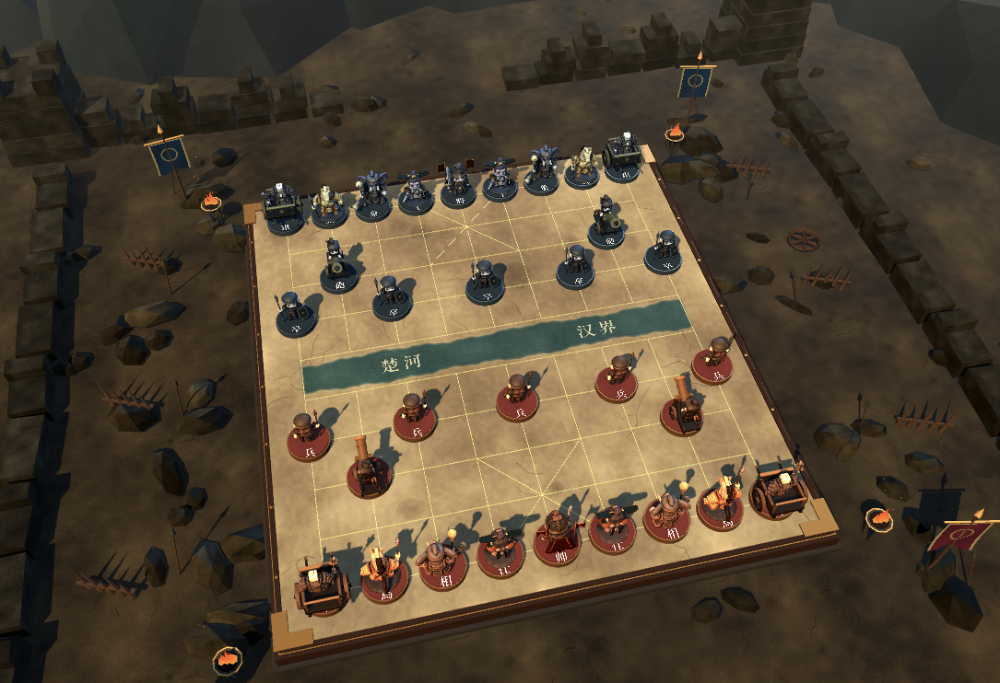
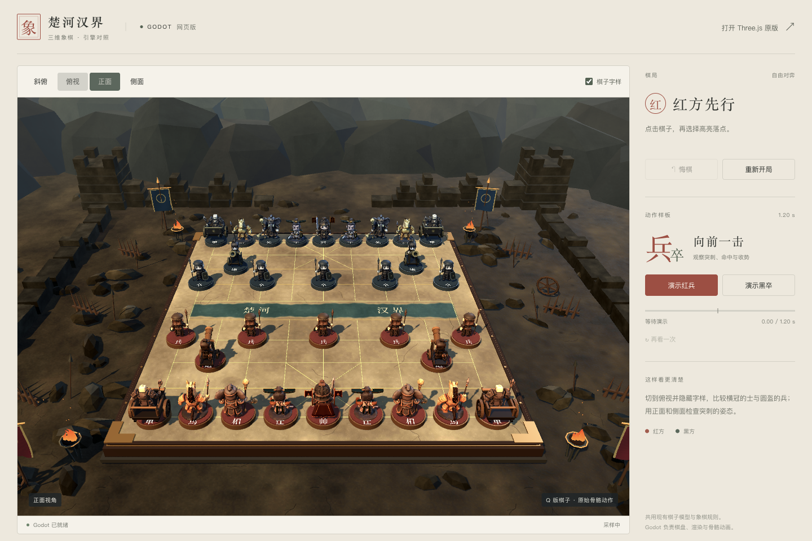
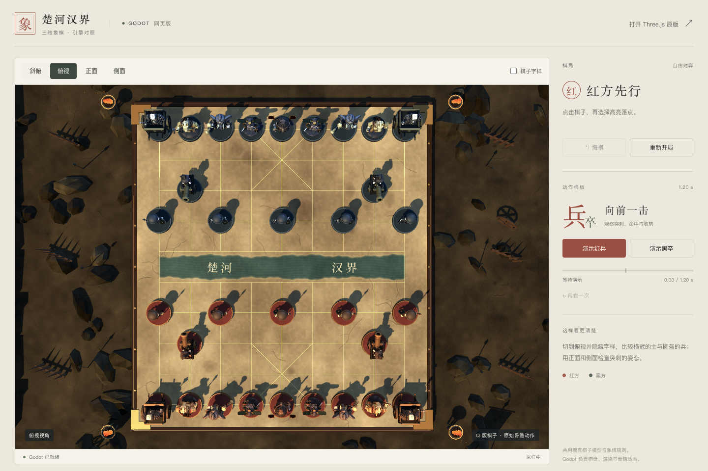
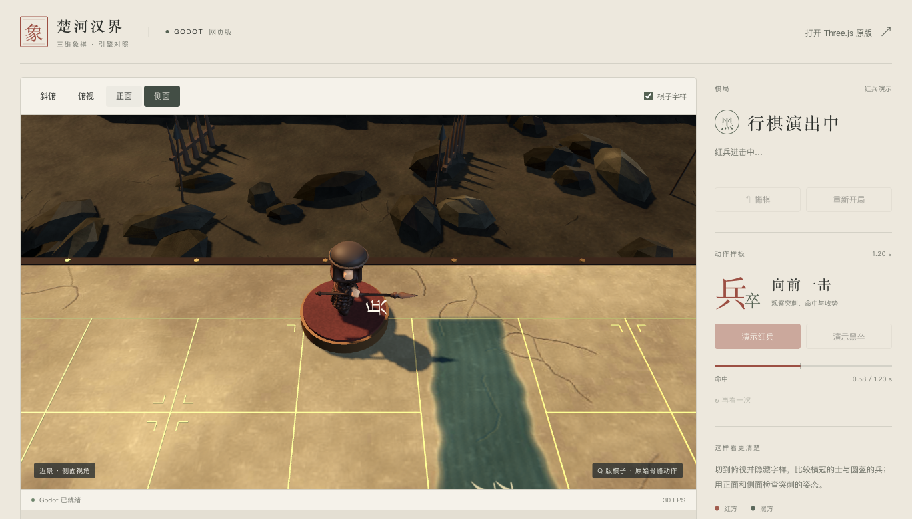

# Godot 战场材质与环境验收 · 2026-10-19

入口：[Godot 网页版](https://tsonglew.github.io/chess-cn/godot/)。本轮仅更新 Godot 对照版；Three.js 原主页发布文件保持不变。

## 画面变化

- 棋盘与地面采用原创可复现的颜色、法线和粗糙度贴图。板面有矿物颗粒、细裂纹、焦痕与青灰河床；棋盘线和文字仍由几何与字体绘制。
- 加入暗木框、磨损金属护角与铆钉，棋子底座改为粗糙漆面。七类 GLB 与原骨骼动作字节均未修改，模型原贴图保留。
- 天空反射、暖色主光、冷色侧光与远处深度雾提供材质明暗层次。没有启用体积雾、SSAO 或额外阴影灯。
- 场景包含风化残墙、碎石、层叠山体、木栅、遗落长矛与车轮、四面红黑战旗，以及四座带火焰、烟尘与余烬的火盆。保留 Q 版低多边形风格。
- 场景重复几何合并为 18 个 MultiMesh，加 13 个普通 MeshInstance；20 团烟尘、24 个余烬均批量绘制。远山与火焰不投射阴影。
- 32 枚棋子的 64 个底座网格改成四个持久 MultiMesh 批次。保留金属边的接触阴影，关闭上层漆面的重复阴影，底座随棋子运动和显隐。

## 验收

最终浏览器检查覆盖 1440×960、1100×800 两种桌面窗口的斜俯、俯视、正面、侧面。32 枚棋子的投影中心与头部均在画布内，场景道具未遮住可走棋区域。隐藏字样的俯视画面保留士的宽横冠与兵的紧凑圆盔差别；这属于开发视觉检查，不是用户盲辨测试。

双阵营兵的 20 骨 SoldierThrust 保持 1.2 秒，0.58 秒命中；合法与非法走子、吃子、悔棋、重开、四视角与标签开关通过回归。最终浏览器没有记录到引擎、着色器或 JavaScript 错误。

底座专项回归覆盖 32→4→3（命中）→4（悔棋）→1（空阵营）→32（重开）。原生 M1 Compatibility 还实际读取了 MultiMesh 变换，核对腾空、命中和父节点变换下的底座世界位置。Godot headless 的虚拟渲染器不能回读这些 GPU 变换，所以 headless 报告明确跳过位置回读，只验证数量与显隐；没有用测试缓存代替真实位置证据。

首轮视觉检查发现自建地面与碎石面绕序错误，已经按 Godot 顺时针正面约定修正，并在真实 WebGL 画面复核；未把 headless 无报错当成视觉通过。

## 性能与包体

Apple M1 / Chromium 154 / ANGLE Metal；可见页面 1368×781，系统 DPR 2，画布渲染比例上限 1.5，32 枚棋子普通实时模式。每版先预热，单次采样约 10 秒；最终样本保持画布焦点并记录 focus / visibility 事件。

| 版本 | 绘制调用 | 观测平均帧率 | 帧间隔中位数 | P95 |
| --- | ---: | ---: | ---: | ---: |
| 原 Godot 版，暖态两次 | 235 | 23.83 / 23.00 FPS | 33.3 / 33.3 ms | 34.3 / 50.0 ms |
| 战场版，底座合批前，暖态两次 | 311 | 23.62 / 14.95 FPS | 33.3 / 33.3 ms | 50.0 / 66.7 ms |
| 最终战场版，底座合批后 | 189 | 17.77 FPS | 33.3 ms | 49.7 ms |

底座合批把同视口绘制调用从 311 降到 189，约减少 39%；最终场景低于原版的 235 次。但**不能据此声称帧率提升或稳定 30 FPS**。前后版本均出现约一秒的周期停顿；最终样本有四次这样的长帧，停顿前引擎报告 29–30 FPS。画布始终有焦点且页面始终可见，所以已排除本次采样中的失焦/切后台，根因仍未定位。原始帧间隔与焦点记录保留，未删除停顿来美化平均数。下一步性能工作应针对长帧定位；本轮交付目标是场景画质。

静态导出总计 50.75 MiB，WASM 37.68 MiB、PCK 12.63 MiB；相对初版原始包体增加约 3.29 MiB。压缩后的实际下载量依托管与缓存而异。移动端按用户指示未进行本轮验证。

## 证据与重建

- `reports/godot-battlefield-framing-final.json`：两种窗口的四视角构图、原模型哈希。
- `reports/godot-battlefield-functional-final.json`：真实 WASM/PCK、WebGL 2、完整交互与骨骼动画回归。
- `reports/godot-battlefield-performance-final.json`、`godot-battlefield-performance-previous-warm-*.json`：最终样本及原版对照。
- `reports/godot-battlefield-performance-prebatch-*.json`：优化前战场版的原始采样。
- `godot-project/textures/manifest.json`：贴图来源、尺寸、生成种子与哈希。
- `tools/build-godot-battlefield-textures.py`：可复现的素材生成脚本。

最终 PCK SHA-256：`be5213700fe7613a5c572fabf246253cbf86ad3e30b5a8542e169315ac4a142d`。

构建仍使用 `node tools/build-godot.mjs`；导出不依赖额外服务或 GitHub Pages 响应头。

