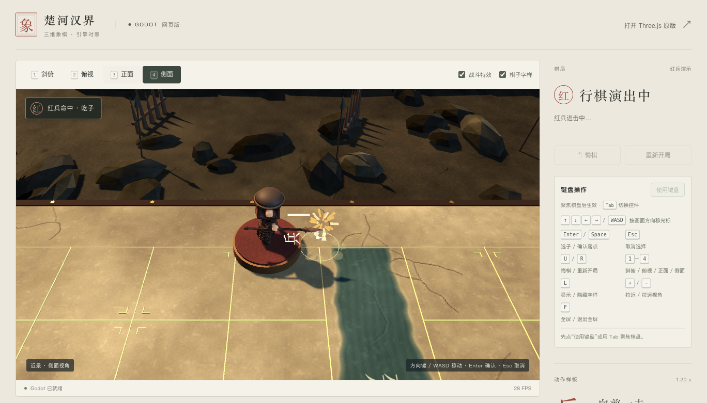

# Godot 动作与战斗特效验收

2026-10-19。保留原七类 GLB、兵的 20 骨 `SoldierThrust`、象棋规则与键盘交互；增加运行时动作、战斗反馈与开关。

- 兵轻迈步，马跃进，车贴地冲锋，炮后坐、发射弧线弹丸后落位；士、象、将各有不同起落幅度。
- 选子呼吸环、起步与落地尘土、命中火花/碎屑/冲击环、兵枪闪和炮弹尾迹。
- 兵仍在 0.58 秒命中，炮在 0.648 秒命中。其他实体吃子进入 1.0 世界单位的三维接触范围后命中，长线车不会提前隔空吃子。
- 边缘短战报显示行棋、吃子、回合、将军与胜负。演出期间侧栏印章显示动作方，结束后切换回合。
- 顶部「战斗特效」开关控制新增粒子与光环。系统减少动态偏好实时关闭跳动、后坐、弹道和呼吸，保留规则位移与兵原骨骼动作。

[马跃进](godot-preview/combat-horse.png) · [炮弹飞行](godot-preview/combat-cannon.png)

## 功能与视觉验证

`combat_smoke`、原 `runtime_smoke` 与 `keyboard_smoke` 均通过。覆盖七类中途姿态、最终落位/回正、原兵骨骼与命中时刻、长线车接触、炮弹命中、普通同步保留收尾、悔棋/重开清理和资源上限。

浏览器验证了七类正常行棋及悔棋、合法九格长线车捕获、炮弹与屏子、双方兵卒突刺、四视角命中截图、实际特效复选框和实时减少动态切换。原 11 项真实键盘/鼠标验收通过。浏览器和引擎无捕获错误。13 张效果截图已实际查看；修正了非均匀缩放导致火花偏向同一世界轴的问题。低正面视角的命中位于棋子身体前方，会有正常的自身遮挡。

- [动作与效果报告](reports/godot-combat-local.json)
- [键盘回归](reports/godot-combat-keyboard.json)
- [模型与导出摘要](reports/godot-assets.json)

## 桌面短时采样

Apple M1 / Chromium / Compatibility，均使用真实时间。下列采样各约 8 秒，代表观察到的显示帧间隔，不是 GPU 耗时或长期稳定帧率。

| 场景 | 视口 / DPR | 平均 FPS | 中位 / P95 帧间隔 | 最长帧 |
| --- | --- | ---: | --- | ---: |
| 改动前静止 32 子 | 1368×781 / 1 | 29.38 | 33.3 / 49.7 ms | 50.8 ms |
| 改动后静止 32 子 | 1368×781 / 1 | 29.50 | 33.3 / 34.4 ms | 51.0 ms |
| 炮击预热后，反复重开并吃子 | 1368×781 / 1 | 29.56 | 33.3 / 34.4 ms | 50.3 ms |
| 未预热的连续炮击，含重开 | 1380×759 / 2 | 21.46 | 33.3 / 50.0 ms | 1083.4 ms |

静止绘制调用保持 189；炮击采样约 190–192，瞬态粒子约 32–35。实现硬上限为 92 粒子、4 个瞬态环，空闲池不逐槽更新，没有增加阴影灯或后处理。

两组炮击的分辨率及预热条件不同，不能据此把长帧归因于某个具体原因，也不能认为它已经修复。之前版本也曾观察到周期长帧。本轮不做持续压力或移动端真机验证；界面保留关闭特效的选项。

[前](reports/godot-combat-performance-before.json) · [后](reports/godot-combat-performance-after.json) · [未预热炮击](reports/godot-combat-performance-active.json) · [预热炮击](reports/godot-combat-performance-active-warm.json)
