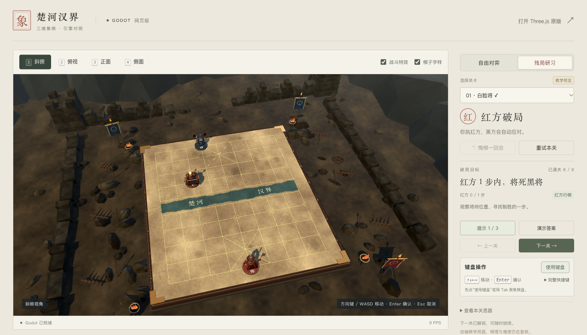
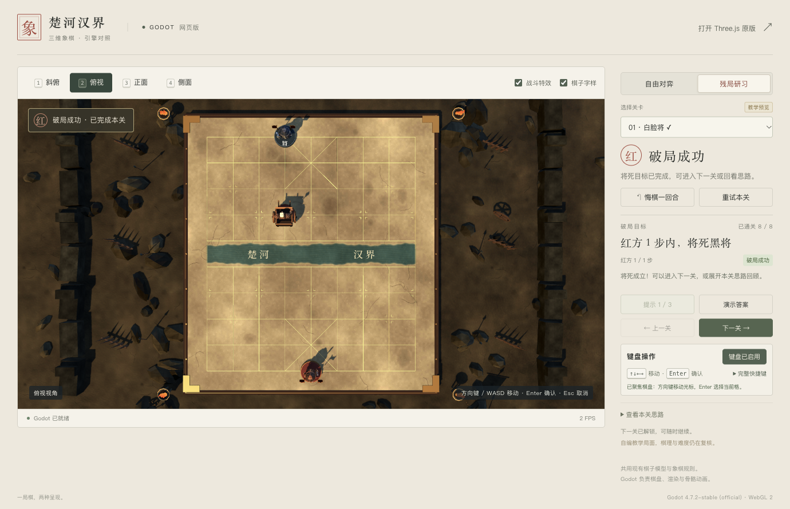

# Godot 网页版残局研习

入口为 `/chess-cn/godot/` 的「残局研习」，也可用 `?mode=puzzle` 直接进入。保留原自由对弈、兵卒演示、键盘操作和战场场景。

## 接入范围

- 原 Three.js 残局入口中的 8 个自编教学预览，题目与解法数据保持原样，仍为 `candidate`，界面标注「教学预览」。自动证明通过，独立棋理与难度复核未完成。
- 复用原 controller / session / position / solution-tree / opponent / hint-copy / progress，包含红方步数目标、自动黑方回应、三级提示、错误分支继续、整回合悔棋、重试、答案演示、逐关解锁和存档恢复。
- 模型、材质与动作没有另建一套。红方、黑方和答案演示都通过原 Godot `move` 播放；车马炮等动作、扬尘、命中火花/冲击环、战报、特效开关与减少动态偏好继续生效。
- 原八题没有兵卒，所以残局实际吃子检查使用「双车破士」，兵的骨骼突刺仍通过既有演示回归，不声称在原题库中测到了兵卒攻击。

## 关键边界

控制器先提交规则结果，Godot 再消费 `before/after/move/captured` 收据。每着有独立 `requestId`，只在匹配的 `move_done` 到达时推进。旧动画取消后不会重新落子；完成回调不再异步同步旧局面，避免把随即开始的黑方动画覆盖。

选子与合法落点使用残局控制器，按将死判定而非吃掉黑将。`U` 撤销红黑完整回合（半轮只撤红方一着），`R` 重试本关；动画期间也可以重试、悔棋、切关或切模式。演示暂存原局，停止后恢复，不记录通关。

修复了原控制器的中断结算遗漏：末着已走出但动画未结束时刷新/暂停，恢复到成功局面后会补记完成。当前会话只结算一次，跨刷新按关卡版本合并最佳着数和提示数。

正常模式共用同源 `chess-cn.progress.v1`；`?test=1` 的验收只写 `chess-cn.godot-test.*`，并检查用户进度未被改动。原进度模块保留串行写入、备份恢复、坏存档隔离及较新版本写保护。保存失败不阻止解题，资源失败显示具体路径并提供重新加载。

## 验收方式

- `node --test test/godot-puzzles.test.js`：16 项通过。逐题重算完整证明并实走控制器，校验原数据摘要、三并发加载上限、网络/数据失败、演示、恢复、迟到回调、损坏/较新版本存档。
- Godot `combat_smoke.gd` 与 `keyboard_smoke.gd`：通过。七类动作、命中时刻、20 骨兵突刺、效果有界回收、键盘映射保持正常。
- `runGodotPuzzleQa`：14 组通过。以真实模式/提示/演示/前后关按钮和键盘完成首关，随后逐关实走全部解法，检查黑方只回应一次、命中特效三视角、悔棋、中途重试、未证明分支继续、两类失败、演示中断、终着刷新、存档故障与原版模式回归。报告：[浏览器全流程](reports/godot-puzzles-local.json)。
- 标准 `develop-web-game` Playwright 客户端初次截图与文本状态通过；最终版使用 Ego 页面完成真实键鼠、逐帧状态及截图复验。软件渲染客户端后续截图读回曾阻塞，未把该次未完成运行计为通过。
- 1368×781 与 1100×800、DPR 1 的主控件均在首屏内，无重叠或横向溢出；展开键盘可见 U/R/Tab 说明。报告：[桌面布局](reports/godot-puzzles-layout.json)。
- 普通网页时钟通过真实键盘通关，并自动播放红黑双方的连续动作，不依赖 `advanceTime`。使用独立临时服务器端口避免改动用户存档。报告：[常速运行](reports/godot-puzzles-realtime.json)。

本轮为桌面网页版功能和视觉验收。没有扩大到手机真机测试，也没有将瞬时 FPS 或确定性推进测试作为性能改善结论。

## 维护

来源、复制摘要和显式预览选项见 [GODOT_PUZZLE_SOURCES.md](GODOT_PUZZLE_SOURCES.md)。更新题库时同步 `web/puzzle/data/` 和来源摘要，重新运行内容及浏览器验收。不要直接修改导出的 `/godot/`；使用 `node tools/build-godot.mjs` 重建，递归导出浏览器模块和题库并生成文件摘要。
