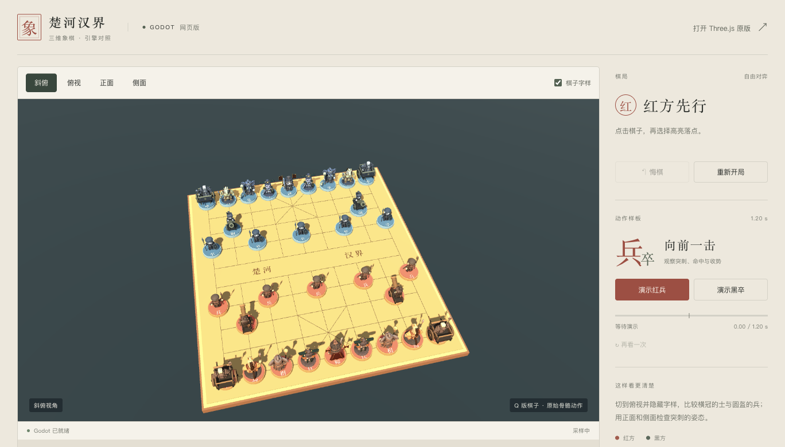
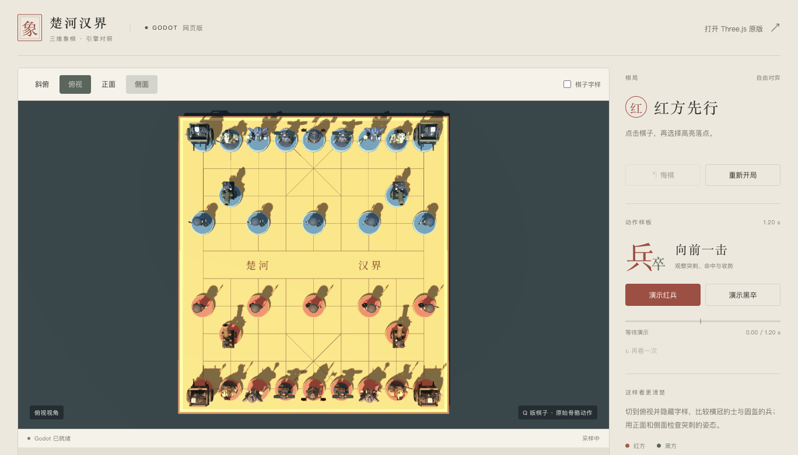
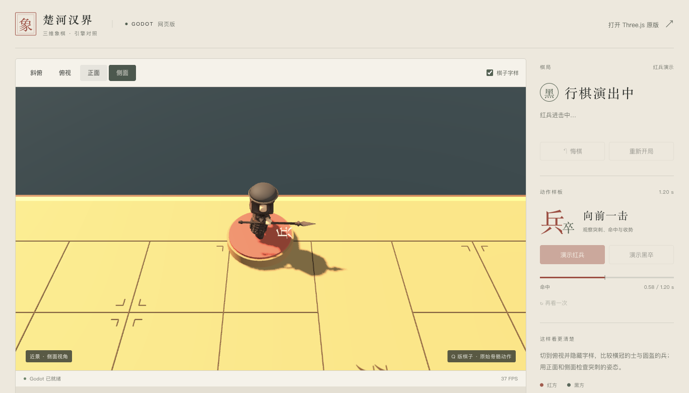

# Godot 网页对照验收 · 2026-10-19

> 下文记录初版引擎对照。当前战场材质与环境、最终截图及新旧同会话性能采样见 [战场升级验收](GODOT_BATTLEFIELD.md)。旧版性能与 PCK 哈希不代表战场版。

入口 https://tsonglew.github.io/chess-cn/godot/ 。原 Three.js 主页 https://tsonglew.github.io/chess-cn/ 保持原发布文件不变。

## 交付范围

- 实际 Godot 4.7.2 Compatibility / WebGL 2 / 单线程 WebAssembly；GitHub Pages 无需额外响应头。
- 七种当前 standard 档 GLB 原样复制，32枚棋子完整布置。兵含20根骨骼，导入16条优化后动画轨道，使用原始 SoldierThrust，时长1.2秒，命中0.58秒。
- 沿用 JavaScript 规则；合法走棋、悔棋、重开；红兵/黑卒近景演示；四视角、拖动旋转、滚轮缩放、标签开关和 F 全屏。
- 修复同一ID换模型时复用旧角色的问题、低视角点击头部错格、画布黑边、过亮板面；126条棋盘线合批。

## 已验证

- 在独立干净检出中重新导出，完整 headless 回归通过；原规则14项测试通过。
- 真实浏览器检查WASM/PCK、32实例/7类模型、合法与非法走子、悔棋/重开和四视角。
- 红/黑兵均在命中前保留目标、命中后隐藏目标；骨骼真实变化，收势后落到目标格。另检查枪尖蒙皮、骨骼独立前刺方向和复位。
- 13张实际渲染截图逐一查看，包括去字俯视与双阵营四视角关键帧。属于开发验收，未进行用户盲测。
- 最终功能报告没有浏览器或引擎错误。真实鼠标在正面低视角点击红兵头部，正确选中棋子23。

## 桌面采样

Apple M1 / ANGLE Metal，Chromium 154，可见页面1368×781、系统DPR2，渲染DPR上限1.5；32枚棋子普通实时模式，等待引擎超过100帧后采样约10秒。

| 指标 | 网格线合批前 | 最终合批版 |
| --- | ---: | ---: |
| 引擎绘制调用 | 486 | 235 |
| 实测帧率 | 29.60 FPS | 29.50 FPS |
| 帧间隔中位数 | 33.3 ms | 33.3 ms |
| 帧间隔P95 | 34.3 ms | 34.4 ms |

合批减少了绘制调用，本次短采样没有可测帧率收益。初次冷启动采样包含一次约1.05秒停顿；单独空白页rAF样本约50FPS，并非环境固定锁30Hz。机器同时有其他工作负载，这些数值不能证明Godot比Three.js快或慢，也不代表长时间稳定性或移动端表现。

导出站点约47.46 MiB（文件原始体积），其中WASM约37.68 MiB、PCK约9.34 MiB。首次网络加载体积取决于托管压缩与缓存。本轮未裁剪通用Godot引擎模板。

## 证据与重建

- `reports/godot-assets.json`：原模型哈希、骨骼/动画、真实导出文件。
- `reports/godot-browser-local-batched.json`：最终功能、桥接状态与资源加载。
- `reports/godot-visual-review.json`：13张截图与产物哈希。
- `reports/godot-animation-geometry.json`：枪尖蒙皮与攻击方向。
- `reports/godot-performance-local*.json`：冷/暖/合批前后原始帧间隔；`godot-browser-raf-baseline.json`：空白页基线。
- 最终PCK SHA-256：`f460cbd413f66035b995c9136638121b42b05388557f9daab0eee61045c10308`。

构建方法见 `../godot-project/README.md`。已有Three.js的未提交修改未混入本次发布；本轮未迁移完整旧版特效、关卡、音效或微信构建。

