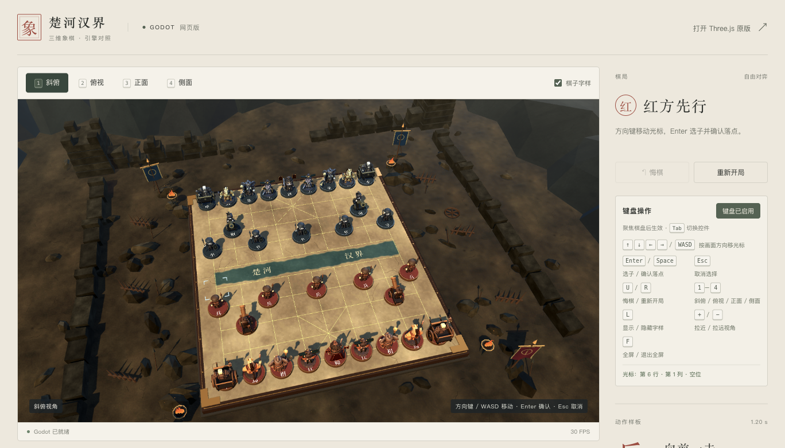

# Godot 网页对照版

独立部署在 https://tsonglew.github.io/chess-cn/godot/ 。仓库根目录继续提供原 Three.js 游戏。

本版用 Godot 4.7.2 的 Compatibility 渲染器绘制棋盘、七种棋子及兵的骨骼突刺；网页控制层复用现有 JavaScript 象棋规则。它是浏览器对照原型，不代表原游戏全部演出、音效、关卡或原生平台已迁移。

## 开发与构建

1. 安装 Godot **4.7.2 stable** 和相同版本的 Web 导出模板。
2. 在 Godot 中打开本目录的 `project.godot`，或在仓库根目录运行 `node tools/build-godot.mjs`。可用 `GODOT_BIN` 指定编辑器可执行文件。
3. 在仓库根目录运行 `python3 -m http.server 8000`，打开 `http://localhost:8000/godot/`。

源码在本目录，生成的静态站点在 `../godot/`。`web/shell.html` 是自定义 HTML 模板；不要手改导出的 `index.html`。构建脚本不会修改 Three.js 的 HTML、JavaScript 或资产。

单线程导出关闭 GDExtension 和 PWA，不需要 COOP/COEP 响应头或 Service Worker。运行需要浏览器支持 WebAssembly 与 WebGL 2。导出产物 `index.html/js/wasm/pck` 必须一起部署，并保留文件名和相对路径。

## 资产复用

`asset-manifest.json` 记录复制来源及 SHA-256。`models/` 中七个文件与当前 Three.js 的 standard 档 GLB 完全相同；兵使用 `assets/models/animated/soldier-standard.glb`，其余使用 `assets/models/readable/*-standard.glb`。Godot 导入后在 PCK 内保存引擎资源。

兵的原动画为 `SoldierThrust`，时长 1.2 秒，命中时刻 0.58 秒。棋盘位移与朝向由运行时控制，关节运动来自 GLB 动画。字体沿用本项目的中文子集，许可见 `fonts/`；引擎及第三方许可见 `licenses/`。

## 战场场景

`battlefield.gd` 构造外围地形、残墙、战旗与火盆。重复环境几何及烟尘/余烬采用 MultiMesh；棋子底座按阵营与层分为四个批次，移动、吃子和重开时随模型同步。`main.gd` 负责棋盘、光照、材质与游戏桥接。

`textures/` 保存已生成的六张 PBR 贴图及清单。需要重建贴图时运行 `python3 tools/build-godot-battlefield-textures.py`（Pillow、NumPy），普通 Godot 导出无需运行 Python。颜色图有裂纹、焦痕及河床，棋盘线和汉字不烘焙进贴图。完整视觉与性能记录见 [战场升级验收](../docs/GODOT_BATTLEFIELD.md)。

## 动作与战斗特效

七类棋子复用原模型，通过运行时位移与姿态表现不同动作：兵轻迈步、马跃进、车贴地冲锋、炮后坐发射、士与将抬步收势、象稳重起落。兵吃子继续使用原 `SoldierThrust` 骨骼动画，命中仍为 0.58 秒；炮先发射弧线弹丸，0.648 秒命中后移至落点。其他实体吃子按接触距离触发，长线车不会提前隔空击中。

选子有呼吸环，走棋与落地扬尘，命中出现短暂火花、碎屑与扩散环。战报显示行棋、吃子、回合与将军。顶部「战斗特效」可随时关闭；系统开启减少动态效果时，取消跃起、后坐、弹道、呼吸和战报滑动，保留规则位移、兵的原骨骼动作和少量命中反馈。

`combat_fx.gd` 使用三个固定 MultiMesh 粒子池，合计最多 92 粒子与 4 个瞬态环，不增加阴影灯或后处理。效果通过与动作共用的时间推进，结束后回收；悔棋、重开与演示重置会清除瞬态效果。普通选择与完成同步保留落地收尾，避免突然截断。

`tests/combat_smoke.gd` 验证七类动作、接触时机、姿态归零与效果上限；`tools/godot-combat-qa.mjs` 的 `runGodotCombatQa(page, options)` 在现有 Ego Page 中验收真实 WebGL 画面、落位/悔棋、特效开关及实时减少动态偏好。新增动作通过浏览器多视角截图检查，性能结论仅限本次桌面短采样，见[动作与战斗特效验收](../docs/GODOT_COMBAT.md)。

## 残局研习

侧栏「残局研习」可进入现有 8 个自编教学预览，也可用 `?mode=puzzle` 直达。玩家执红方，在指定红方着数内将死黑将；黑方由原残局控制器自动应对。题库仍标注教学预览，尚未完成独立棋理与难度复核。

支持逐关解锁、三级提示、完整答案演示与返回原局、偏离解法后继续尝试、整回合悔棋、重试以及通关/棋局恢复。演示不记录通关。原版通关数据使用同源的 `chess-cn.progress.v1`；测试模式使用独立前缀，不覆盖用户记录。资源失败可直接重新加载，保存失败会显示提醒并允许继续行棋。

每一步复用现有 Godot 动作与特效，收到对应动作编号的完成事件后才允许下一步。切关、悔棋、重试和切模式会取消旧演出，避免黑方多走一次。`U` 在残局撤销一整回合，`R` 重试当前关，动画期间也可取消重试；方向键/Enter 的规则不变。

`web/puzzle/` 是原题库与纯逻辑的独立复制，`web/puzzle-mode.js` 负责进度和生命周期装配，`web/host.js` 将控制器收据接到 Godot。来源与最小适配见[来源说明](../docs/GODOT_PUZZLE_SOURCES.md)，验收见[残局网页版验收](../docs/GODOT_PUZZLES.md)。

运行 `node --test test/godot-puzzles.test.js` 验证题库与控制器；`tools/godot-puzzle-qa.mjs` 的 `runGodotPuzzleQa(page, options)` 覆盖浏览器全流程。

## 发布与回滚

现有 GitHub Pages 使用 `master` 分支根目录。发布只需更新 `godot/` 及对应源码/构建脚本，保持根目录 Three.js 文件不变。浏览器入口为 `/chess-cn/godot/`，返回链接为 `../`。

回滚时撤销仅增加/修改 Godot 子目录的发布提交即可；原首页无需切换。不要将本地其他未完成的 Three.js 修改一并提交。

## 验收入口

页面提供正常棋局、残局研习、红兵/黑卒突刺演示、重播、悔棋、重开、四个视角和名字标签开关。`?test=1` 使用可控时间供自动化验收；普通用户使用不带该参数的网址。

### 键盘操作

点击侧栏“使用键盘”，或用 Tab 聚焦棋盘。浅蓝色角框表示当前光标，金色圈表示已选棋子，绿色标记表示合法落点。按键提示常驻侧栏，全屏时棋盘底部保留基础提示。

| 按键 | 操作 |
| --- | --- |
| 方向键 / WASD | 按当前画面方向移动一个棋格；支持长按，边界停留 |
| Enter / Space | 选中己方棋子，或确认合法落点 |
| Esc | 取消选择；全屏时也可退出全屏 |
| U / R | 悔棋 / 重新开局 |
| 1 / 2 / 3 / 4 | 斜俯 / 俯视 / 正面 / 侧面 |
| L | 显示或隐藏棋子字样 |
| + / − | 拉近或拉远视角（无需 Shift 的 = 也可拉近） |
| F | 切换全屏 |
| Tab / Shift+Tab | 离开棋盘，切换网页控件 |

快捷键仅在棋盘获得焦点时生效。鼠标点击棋格会隐藏键盘角框，下一次方向键从该棋格继续；动作期间暂停选子和移动，视角和缩放仍可使用。自由对弈在动作期间暂停悔棋与重开；残局允许悔棋、重试和切关来取消当前演出。系统组合键、中文输入法和页面原生控件保留各自行为。

运行 `node tools/godot-assets.mjs` 检查模型哈希、骨骼与动画和 Web 导出配置。原 Three.js 源模型不在当前检出中时，此脚本仍校验复制模型与资产清单的一致性，并明确标注没有执行源文件比对。

运行 `Godot --headless --path godot-project --script tests/runtime_smoke.gd` 验证模型切换、真实骨骼前刺、命中时序、落点和32枚棋子恢复（将 `Godot` 替换为本机可执行文件）。浏览器验收使用 `tools/godot-browser-acceptance.mjs` 导出的 `runGodotAcceptance(page, options)`；`page` 为 ego-browser 当前任务空间中的页面，不另启动浏览器。

`tests/keyboard_smoke.gd` 通过相同命令验证光标方向、边界、缩放限位和动画互斥。浏览器键盘验收使用 `tools/godot-keyboard-qa.mjs` 的 `runGodotKeyboardQa(page, options)`，以真实按键及鼠标检查行棋、快捷键、焦点、输入法保护和全屏。

编辑器原生运行可预览棋盘；本轮交互规则通过 Web JavaScriptBridge 接入。Godot 导入器保留默认网格 LOD，桌面采样因此不能直接与旧 Three.js 数据做同条件性能比较。浏览器验收与实测结论见 `docs/reports/godot-*`。移动端真机验证不在此次范围内。
